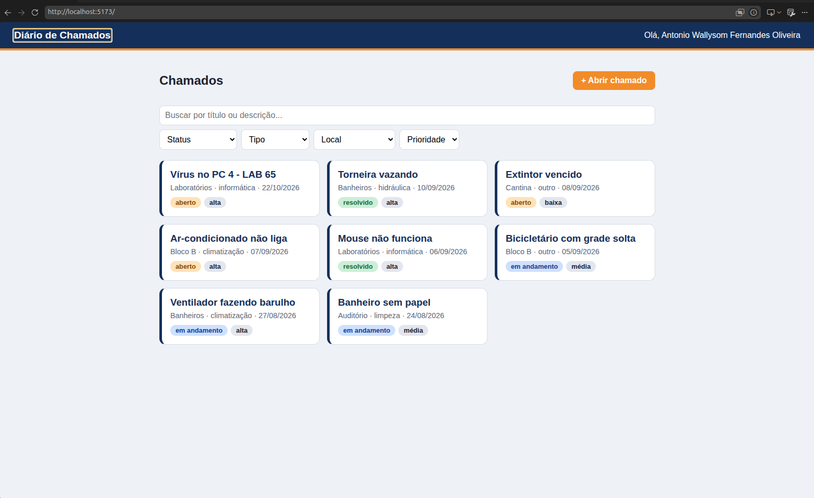

# Diário de Chamados

Front-end do sistema de chamados de manutenção do IFRN, feito com React + Vite.

## O que faz
- Mostra o nome do aluno dono da chave
- Lista chamados com busca e filtros por status, tipo, local e prioridade
- Abre, edita e exclui chamados
- Inicia o atendimento e resolve chamados

## Tecnologias
React, Vite, React Router e Axios

## Como rodar
1. npm install
2. Crie um arquivo .env com VITE_API_KEY=sua-chave
3. npm run dev

## Tela inicial

